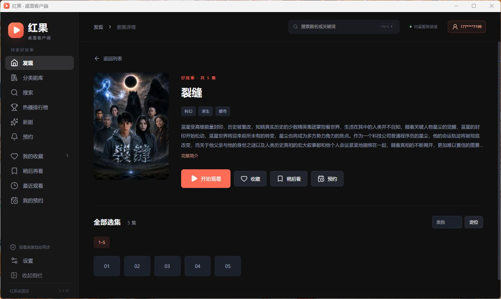
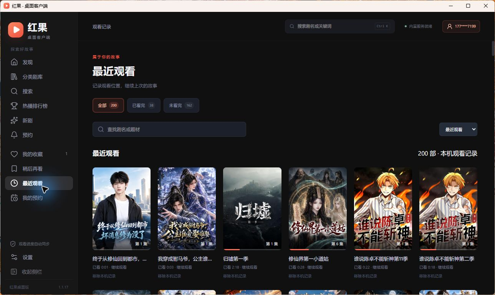

# 红果桌面版

为 Windows PC 打造的非官方红果短剧客户端。用更适合桌面的布局，浏览短剧与漫剧、切换推荐故事、管理片单，并接着上次的进度继续看。

[Gitee 下载](https://gitee.com/weboo_admin/hongguo-desktop/releases) · **[下载最新版本](https://github.com/a312354805/hongguo-desktop/releases/latest)** · [全部版本](https://github.com/a312354805/hongguo-desktop/releases) · [反馈问题](https://github.com/a312354805/hongguo-desktop/issues)

> 当前版本 **1.1.22** · Windows x64 安装版 · 约 **85.8 MiB**。本仓库用于桌面版分发、使用说明与界面展示。

## 下载安装

1. 打开 [最新 Release](https://github.com/a312354805/hongguo-desktop/releases/latest)，下载名称以 `x64-setup.exe` 结尾的安装包。
2. 运行安装程序，完成安装后打开「红果桌面版」。
3. 从「发现」直接开始浏览，或通过分类剧库、搜索、排行榜寻找想看的内容。

**[下载 1.1.22 安装包](https://github.com/a312354805/hongguo-desktop/releases/download/v1.1.22/hongguo-desktop-1.1.22-remote-signing-x64-setup.exe)**

- 面向 Windows 10 / 11 的 x64 设备。
- 不需要另外安装 Node.js、Docker，或手动配置本地内容服务。
- 首次启动会检测 WebView2 运行时与当前用户的 HEVC 视频扩展，缺少时自动调用内置微软签名组件安装，并重新检查；已有组件直接跳过。
- WebView2 补装需要联网。若系统策略、权限或许可阻止 HEVC 安装，会显示错误与继续/退出选项。
- 部分电脑只有声音、进度正常但视频黑屏，与缺少 HEVC 解码支持有关；已有用户安装 HEVC 后恢复画面，并确认自动准备流程可用。
- 浏览内容与播放视频需要联网；在线请求优先在本机签名，可识别的签名失败时回退现有远程服务；内容是否可用也取决于第三方接口。已下载分集可离线播放。

Release 同时提供 `SHA256SUMS.txt` 和应用内更新使用的 `.sig` 文件。普通安装只需下载 `.exe`。需要校验时，可在 PowerShell 中运行：

```powershell
Get-FileHash .\hongguo-desktop-1.1.22-remote-signing-x64-setup.exe -Algorithm SHA256
```

1.1.22 安装包的 SHA-256：

```text
37a62458f502e9fbadf0bb9a76f107814365babc405d458c2f55b1a8387910ef
```

## 界面预览

以下截图均来自 Windows 桌面客户端 1.1.17 的实际运行界面。内容为拍摄时的示例，推荐与榜单会随时间变化。

### 发现：一屏一个故事

推荐、漫剧、真人剧、关注四个频道；滚轮或方向键切换故事，频道缓存与内容预取减少等待。视频信息和播放控件常驻，也可以手动清屏。


### 分类剧库：按偏好找剧

浏览分类与筛选结果，通过海报、标签和剧集信息挑选内容。


### 热播排行榜：看看大家在追什么

在榜单中查看热门内容，直接打开详情或开始播放。


### 剧集详情：简介、收藏与选集

查看故事简介和剧集目录，收藏、加入稍后再看，或选择一集开始播放。



### 最近观看：接着上次的故事

查看本机观看记录，按已看完、未看完筛选，快速回到上次的集数和播放位置。



### 我的预约：同步追踪想看的新剧

登录后同步云端预约片单，分开查看已上线和待上线的内容；已上线的剧集可以直接开始观看。


## PC 端功能

| 功能 | 支持内容 |
| --- | --- |
| 发现视频流 | 推荐 / 漫剧 / 真人剧 / 关注，滚轮与上下键切换、频道缓存、后续内容预取、点击播放或暂停 |
| 找剧 | 分类剧库、关键词搜索、热播排行榜、新剧、预约入口 |
| 剧集播放 | 选集、上一集 / 下一集、断点续播、自动连播、弹幕开关、全屏 |
| 播放设置 | 多档倍速、音量与静音、可用清晰度切换、完整画面 / 等比铺满 / 拉伸铺满 |
| 定时停止 | 15 / 30 / 60 / 90 分钟后停止播放 |
| 个人片单 | 我的收藏、稍后再看、最近观看、我的预约 |
| 账号同步 | 手机号登录后使用云端片单与观看进度同步；预约等账号功能需要登录 |
| 桌面体验 | 默认中文深色界面、可折叠侧栏、系统托盘、原生小窗与可自定义老板键；小窗下仍控制同一播放窗口 |
| 本机下载 | 整剧封面卡片、已下载 / 总集数、分集离线播放、补下载、任务管理及合并 |
| 播放自检 | H.264 / HEVC 本地样片测试、播放错误分类与视频帧诊断 |
| 数据与更新 | JSON 备份导出 / 导入、安装版应用内检查更新与下载安装；设置页顶部提供 GitHub 项目信息入口 |

清晰度、弹幕、账号同步及预约等功能以具体内容和上游接口实际支持情况为准。

## 快捷操作

| 场景 | 操作 |
| --- | --- |
| 全局搜索 | `Ctrl + K` |
| 发现页切换故事 | 鼠标滚轮、`↑` / `↓` |
| 播放 / 暂停 | 点击视频，或按 `空格` |
| 剧集播放器快退 / 快进 | `←` / `→`，每次 10 秒 |
| 剧集播放器打开选集 | `↓` |
| 剧集播放器全屏 | `F` |
| 剧集播放器返回 | `Esc` |
| 老板键 | 默认 `F9`，可在设置中修改 |

快捷键在对应页面和播放器获得焦点时使用；输入搜索文字时，方向键与空格按输入框行为处理。

## 更新与数据

- 安装版支持启动后检查更新，也可以在设置中手动检查；下载与安装前会询问用户。
- 覆盖安装保留应用数据。重要片单建议先通过设置导出 JSON 备份。
- 收藏、稍后再看、观看记录和播放设置保存在本机用户数据目录；登录后可使用对应的云端同步能力。
- 本仓库提供 GitHub 下载入口；应用内更新继续使用客户端配置的更新渠道。

### 1.1.22 更新摘要

- 下载按整部剧展示，支持选集离线播放及补下载未保存的分集，保留暂停、重试、删除和合并。
- 修复原生小窗与 F9 老板键之间的窗口恢复问题。
- 弹幕设置集中到控制栏，精简详情信息，默认使用中文深色界面。
- 本地签名优先，可识别的失败回退现有远程服务；修复热播排行榜数据获取。
- 新增播放自检与解码诊断，保留 WebView2 / HEVC 组件准备。

## 反馈问题

请在 [Issues](https://github.com/a312354805/hongguo-desktop/issues) 中提供客户端版本、Windows 版本、复现步骤和必要截图。请遮盖手机号、Cookie、访问凭证等个人信息。

## 说明与许可

本项目为非官方客户端，与红果官方无隶属或背书关系。视频、海报及相关内容的权利归各自权利人所有；客户端不附带影视内容，内容由第三方服务提供。

项目许可证为 [GNU GPL v3.0](LICENSE)。第三方依赖保留各自许可证。
