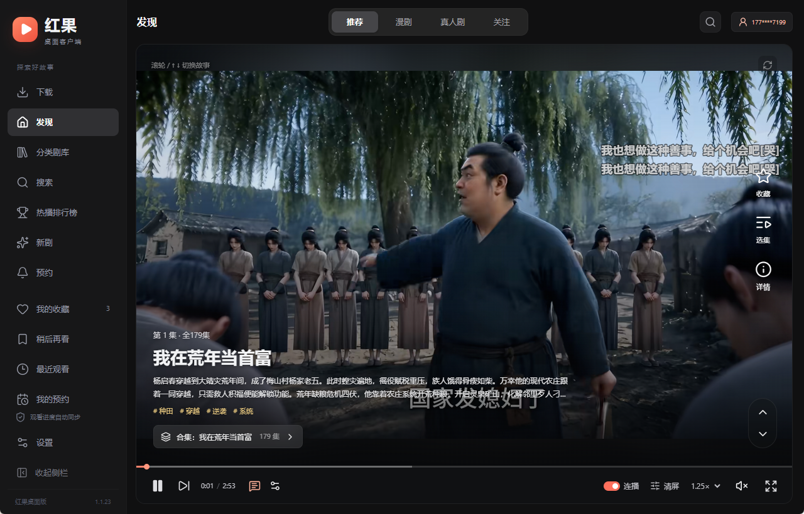
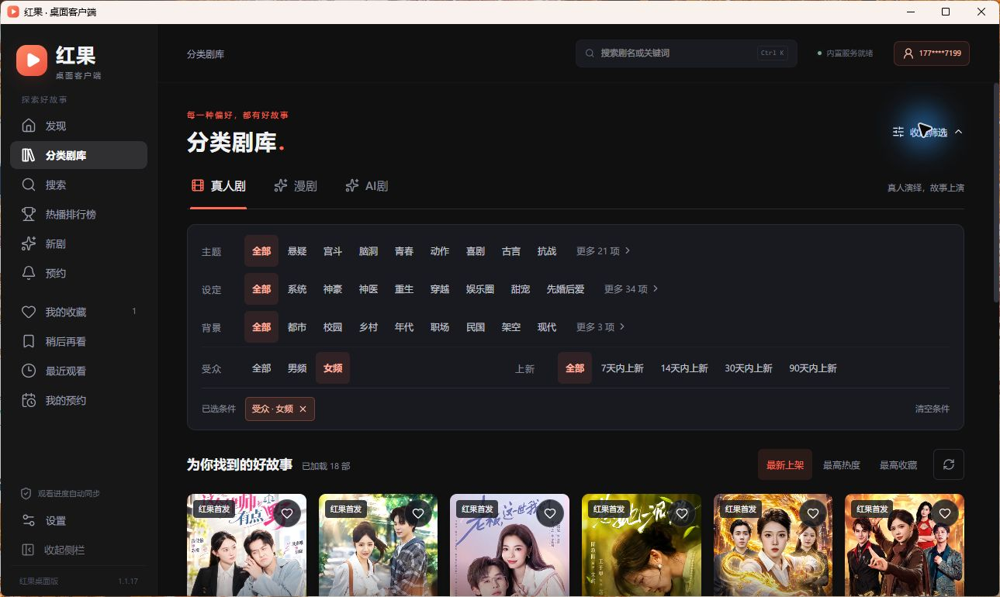
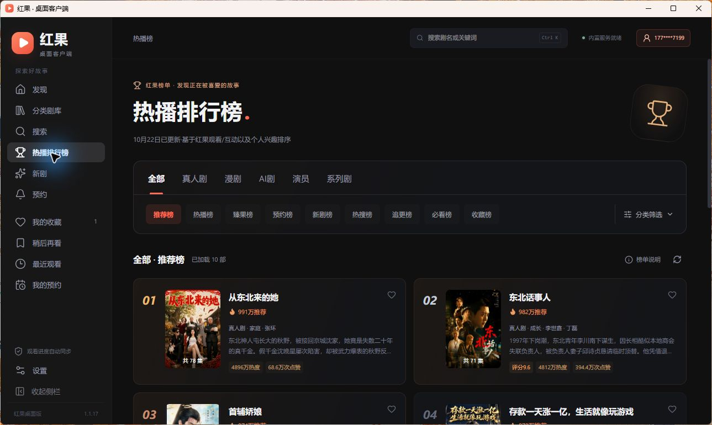
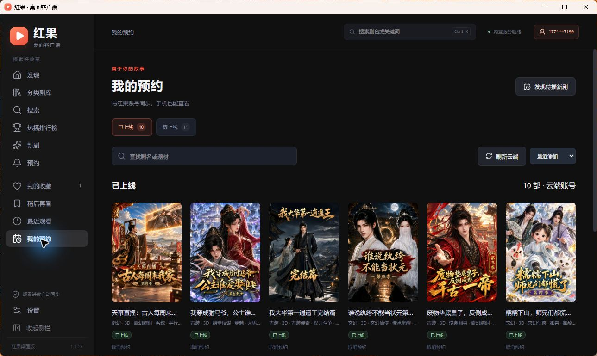
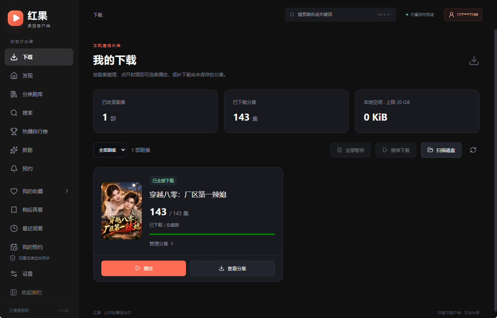
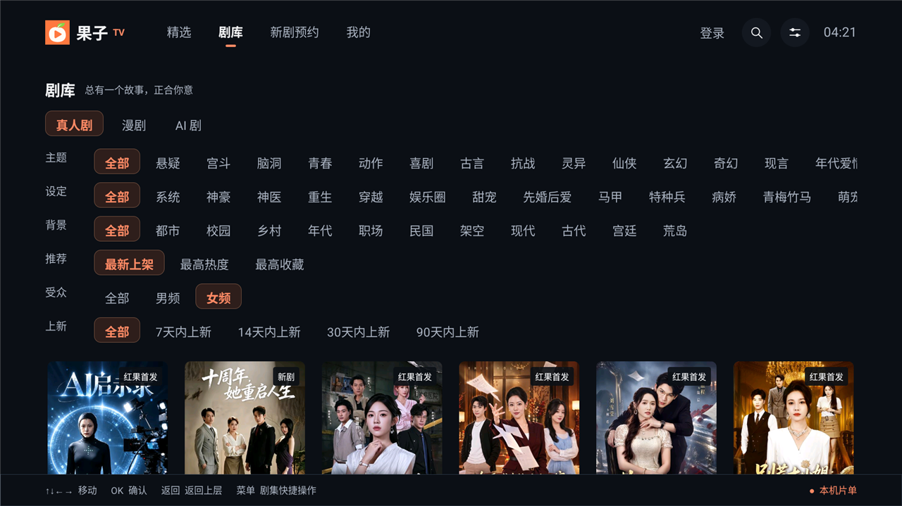
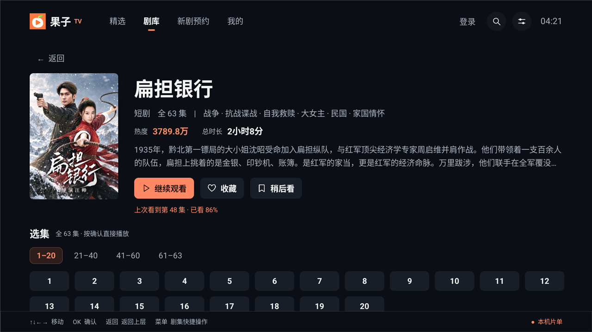
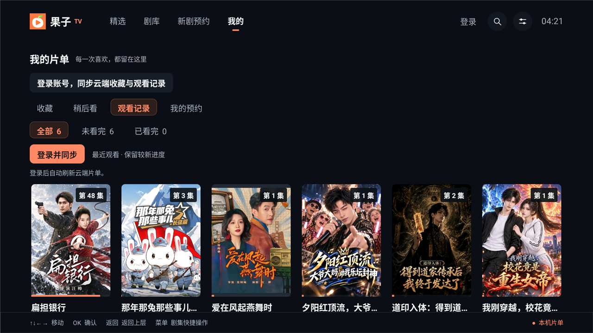
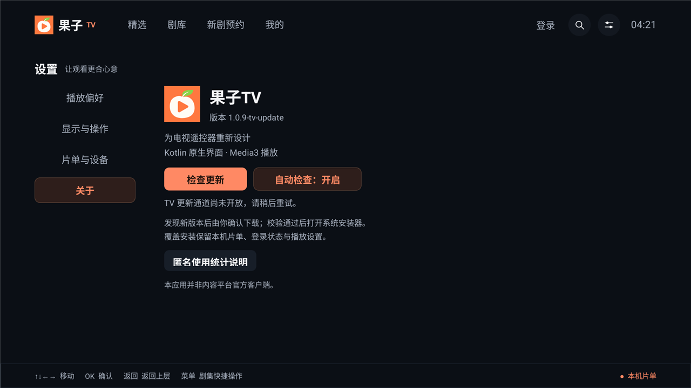

# 红果桌面版 · 果子TV

为 Windows PC 打造的非官方红果短剧客户端。用更适合桌面的布局，浏览短剧与漫剧、切换推荐故事、管理片单，并接着上次的进度继续看。

另提供 **果子TV**：面向 Android 电视和遥控器重新设计的大屏客户端，支持热播精选、分类剧库、手机扫码输入、账号同步与应用内更新。两个客户端共用本仓库与这份说明。

[Windows 下载](#windows-下载安装) · [果子TV 介绍与安装](#果子tv) · [GitHub 发行版](https://github.com/a312354805/hongguo-desktop/releases) · [Gitee 发行版](https://gitee.com/weboo_admin/hongguo-desktop/releases) · [反馈问题](https://github.com/a312354805/hongguo-desktop/issues)

> **Windows 1.1.27** · Windows 10 / 11 x64 · 约 **29.04 MiB**。

> **果子TV 1.0.11** · Android 8.0 及以上 · 约 **8.3 MiB**。TV 安装包已提供 GitHub / Gitee 下载入口。

## Windows 下载安装

1. 打开 [Windows 1.1.27 发行页](https://github.com/a312354805/hongguo-desktop/releases/tag/v1.1.27)，下载名称以 `x64-setup.exe` 结尾的安装包。
2. 运行安装程序，完成安装后打开「红果桌面版」。
3. 从「发现」直接开始浏览，或通过分类剧库、搜索、排行榜寻找想看的内容。

**[下载 1.1.27 安装包](https://github.com/a312354805/hongguo-desktop/releases/download/v1.1.27/hongguo-desktop-1.1.27-remote-signing-x64-setup.exe)** · **[Gitee 下载](https://gitee.com/weboo_admin/hongguo-desktop/releases/download/v1.1.27/hongguo-desktop-1.1.27-remote-signing-x64-setup.exe)**

- 面向 Windows 10 / 11 的 x64 设备。
- 不需要另外安装 Node.js、Docker，或手动配置本地内容服务。
- 首次启动会检测 WebView2 运行时与当前用户的 HEVC 视频扩展，缺少时自动调用内置微软签名组件安装，并重新检查；已有组件直接跳过。
- WebView2 补装需要联网。若系统策略、权限或许可阻止 HEVC 安装，会显示错误与继续/退出选项。
- 部分电脑只有声音、进度正常但视频黑屏，与缺少 HEVC 解码支持有关；已有用户安装 HEVC 后恢复画面，并确认自动准备流程可用。
- 浏览内容与播放视频需要联网；在线请求优先在本机签名，可识别的签名失败时回退现有远程服务；内容是否可用也取决于第三方接口。已下载分集可离线播放。

FFmpeg 不再随安装包分发，首次需要兼容转码时自动下载约 82 MiB 的组件，核验压缩包和解压后程序的大小及 SHA-256 后缓存本机，后续可离线复用。普通播放无需下载此组件。

Release 同时提供 `SHA256SUMS.txt` 和应用内更新使用的 `.sig` 文件。普通安装只需下载 `.exe`。需要校验时，可在 PowerShell 中运行：

```powershell
Get-FileHash .\hongguo-desktop-1.1.27-remote-signing-x64-setup.exe -Algorithm SHA256
```

1.1.27 安装包的 SHA-256：

```text
c7192cd0c251d28839c651362cb56d9c4a116f4ba444d9997c59cd1f7c442cc5
```

## Windows 界面预览

以下截图来自 Windows 桌面客户端的实际运行界面。内容为拍摄时的示例，推荐与榜单会随时间变化。

### 发现：一屏一个故事

推荐、漫剧、真人剧、关注四个频道；滚轮或方向键切换故事，频道缓存与内容预取减少等待。视频信息和播放控件常驻，也可以手动清屏。



### 分类剧库：按偏好找剧

浏览分类与筛选结果，通过海报、标签和剧集信息挑选内容。



### 热播排行榜：看看大家在追什么

在榜单中查看热门内容，直接打开详情或开始播放。



### 我的预约：同步追踪想看的新剧

登录后同步云端预约片单，分开查看已上线和待上线的内容；已上线的剧集可以直接开始观看。



### 我的下载：管理本机离线片库

按剧集整理已下载内容，查看已下载与总集数，播放本机分集，或补下载尚未保存的分集。



## PC 端功能

| 功能 | 支持内容 |
| --- | --- |
| 发现视频流 | 推荐 / 漫剧 / 真人剧 / 关注，滚轮与上下键切换、频道缓存、后续内容预取、点击播放或暂停 |
| 找剧 | 分类剧库、关键词搜索、热播排行榜、新剧、预约入口 |
| 剧集播放 | 选集、上一集 / 下一集、断点续播、自动连播、弹幕开关、全屏 |
| 播放设置 | 多档倍速、音量与静音、可用清晰度切换、完整画面 / 等比铺满 / 拉伸铺满 |
| 定时停止 | 15 / 30 / 60 / 90 分钟后停止播放 |
| 个人片单 | 我的收藏、稍后再看、最近观看、我的预约 |
| 账号同步 | 手机号登录后使用云端片单与观看进度同步；预约等账号功能需要登录 |
| 桌面体验 | 默认中文深色界面、可折叠侧栏、系统托盘、无原生标题栏小窗与可自定义老板键；鼠标移出小窗后隐藏视频信息和控制栏，小窗下仍控制同一播放窗口 |
| 本机下载 | 整剧封面卡片、已下载 / 总集数、分集离线播放、补下载、任务管理及合并 |
| 播放自检 | H.264 / HEVC 本地样片测试、播放错误分类与视频帧诊断 |
| 数据与更新 | JSON 备份导出 / 导入、安装版应用内检查更新与下载安装；设置页顶部提供 GitHub 项目信息与 TV 版 Gitee 下载入口 |

清晰度、弹幕、账号同步及预约等功能以具体内容和上游接口实际支持情况为准。

## Windows 快捷操作

| 场景 | 操作 |
| --- | --- |
| 全局搜索 | `Ctrl + K` |
| 发现页切换故事 | 鼠标滚轮、`↑` / `↓` |
| 播放 / 暂停 | 点击视频，或按 `空格` |
| 剧集播放器快退 / 快进 | `←` / `→`，每次 10 秒 |
| 剧集播放器切换上一集 / 下一集 | 鼠标上滚 / 下滚，或 `↑` / `↓` |
| 剧集播放器打开选集 | `E` |
| 剧集播放器全屏 | `F` |
| 剧集播放器退出全屏 / 返回 | `Esc`，全屏时优先退出全屏 |
| 老板键 | 默认 `F9`，可在设置中修改 |

快捷键在对应页面和播放器获得焦点时使用；输入搜索文字时，方向键与空格按输入框行为处理。

## Windows 更新与数据

- 安装版支持启动后检查更新，也可以在设置中手动检查；下载与安装前会询问用户。
- 覆盖安装保留应用数据。重要片单建议先通过设置导出 JSON 备份。
- 收藏、稍后再看、观看记录和播放设置保存在本机用户数据目录；登录后可使用对应的云端同步能力。
- 本仓库提供 GitHub 下载入口；应用内更新继续使用客户端配置的更新渠道。

### 1.1.27 更新摘要

1. **重新整理合并视频功能**：下载页分开管理“下载剧集”和“合并视频”。支持逐集选择、全选已下载分集和按集数范围选择，按集号合并为一个 MP4，原分集文件继续保留。
2. **优化快速无损合并**：检查视频与音频的关键参数，码率或平均帧率不同不再直接判为不兼容；参数不匹配时指出对应分集和差异，并提供改用兼容合并的入口。
3. **增加合并失败提醒与处理入口**：任务失败后，即使正在浏览其他页面或播放视频，也能看到提醒并跳转查看原因；支持重新选择分集、改用兼容合并重试，并集中查看正在处理、失败、已完成和已取消的任务。
4. **新增单实例运行**：再次打开客户端时恢复并聚焦已有窗口，避免重复启动多个客户端及内容进程。

### 1.1.26 更新摘要

1. **优化发现页切换**：改进视频预加载与播放衔接，复用已准备的播放数据，减少切换时的等待。
2. **优化暂停后继续播放**：正常暂停时保留当前播放会话，恢复播放优先接续已有缓冲，减少重复加载。
3. **加快历史续播**：从观看历史继续未看完的剧集时，优先按已保存的集数和进度启动播放，分集列表在后台补齐。
4. **优化选集播放速度**：提前准备目标剧集，减少重复解析与播放初始化，缩短“正在准备播放”和“正在缓冲”的等待时间。
5. **新增键盘切集**：播放时按 ↑ 切换上一集，按 ↓ 切换下一集；输入文字或操作菜单时不会误切集。
6. **修复小窗恢复异常**：修复小窗模式下使用 Win+D 显示桌面后，窗口无法重新显示的问题，改善最小化后的窗口恢复。
7. **新增意见反馈**：“设置”下方新增“反馈”入口，可提交程序问题、播放问题和功能建议，提交后直接通知作者。
8. **修复窗口无响应**：修复程序启动及恢复窗口时可能出现界面无响应的问题。

继续保留 1.1.25 的播放防休眠、滚轮切集、固定自动连播开关、云端历史合并、下载续播、合并视频播放器及 ESC 退出全屏等功能。

### 1.1.25 更新摘要

- **播放防息屏**：播放视频时阻止 Windows 自动息屏和休眠，暂停或退出播放后恢复正常电源策略。
- **滚轮切换上下集**：在剧集播放画面中，上滚切换上一集，下滚切换下一集。
- **自动连播更方便**：自动连播开关固定显示在播放器操作栏，方便随时调整。
- **优化 ESC 操作**：全屏状态下按 ESC 优先退出全屏，不再直接返回上一页。
- **云端观看记录合并**：最近观看新增“读取并合并云端记录”入口，按更新时间保留较新的观看进度。
- **下载视频支持续播**：“我的下载”可根据观看历史恢复对应集数和播放位置。
- **升级合并视频播放器**：合并视频使用完整播放器，独立保存观看进度，支持从下载列表或最近观看继续播放。

### 1.1.24 更新摘要

- 下一集提前准备首帧，不启动音频播放；准备完成后停止继续读取，减少切集等待。
- 复用当前、下一集与上一集的原生播放器，最多保留三个槽位；切换时立即显示已准备的画面。
- 后台只允许一个下一集预加载任务，当前播放稳定后再启动；暂停、卡顿、切换和窗口隐藏时取消尚未完成的预加载。
- 发现页只预加载紧邻的下一条，减少后台网络与解码资源争用。
- 移除播放时的解码方式及解码切换提示，保留正常缓冲、组件下载 / 校验和真实错误提示。
- 修复快速连续切集时的缓存淘汰，以及停放播放器因缓冲队列满而触发的后台重试。

### 1.1.23 更新摘要

- 安装包缩减至约 28.86 MiB，FFmpeg 改为首次兼容转码时下载、校验并缓存本机。
- 转码组件优先从 Gitee 下载，失败回退 GitHub；支持取消、失败重试和缓存损坏后重新下载。
- 画中画与小窗去掉原生标题栏，鼠标移出隐藏视频信息与控制栏，移入恢复。
- 退出小窗恢复原窗口状态，保留 F9 老板键和托盘收起 / 恢复。

### 1.1.22 更新摘要

- 下载按整部剧展示，支持选集离线播放及补下载未保存的分集，保留暂停、重试、删除和合并。
- 修复原生小窗与 F9 老板键之间的窗口恢复问题。
- 弹幕设置集中到控制栏，精简详情信息，默认使用中文深色界面。
- 本地签名优先，可识别的失败回退现有远程服务；修复热播排行榜数据获取。
- 新增播放自检与解码诊断，保留 WebView2 / HEVC 组件准备。

## 果子TV


为电视和遥控器打造的非官方红果短剧客户端。采用 Kotlin 原生界面和 Media3 播放器，针对电视大屏、方向键焦点和遥控器操作重新设计。

打开精选找热播，在剧库按分类筛选，也可以拿起手机扫码输入剧名。运行时不需要电脑协助。

### 功能亮点

| 功能 | 可以做什么 |
| --- | --- |
| 热播精选 | 热播排行榜，支持一级分类、二级榜单和筛选；每页 24 部、每行 6 部，切换时保留画面，加载成功后替换内容 |
| 分类剧库 | 浏览真人剧、漫剧、AI 剧，按接口提供的分类、条件和排序查找作品 |
| 剧集详情 | 铺满式封面、剧情介绍、热度、总时长、选集与系列剧；缺失数据明确提示 |
| 播放体验 | 断点续播、自动连播、清晰度、倍速和画面模式；下一集预加载，减少切集等待 |
| 弹幕 | 支持表情显示与样式设置，过滤包含“参与弹幕活动”的弹幕 |
| 中文搜索 | 遥控器拼音选字、系统键盘、同一局域网手机扫码输入 |
| 登录与同步 | 手机号验证码登录及平台安全验证，收藏、观看记录和预约一键同步 |
| 我的片单 | 收藏、稍后看、当前集数与观看进度条；记录支持全部、未看完、已看完，预约区分已上线和待上线 |
| 应用更新 | 应用内检查更新、查看更新说明、下载及校验安装包，再交由系统确认安装 |

### 界面预览

以下截图来自 Android 模拟器的实际运行画面。剧目、榜单和部分界面细节会随版本与接口数据变化。

| 热播精选 | 分类剧库 |
| --- | --- |
|  |  |
| 剧集详情 | 观看记录 |
|  |  |

**关于与检查更新**



### 下载安装

**果子TV 1.0.11**：**[Gitee 下载 APK](https://gitee.com/weboo_admin/hongguo-desktop/releases/download/tv-v1.0.11/guozi-tv-1.0.11-universal.apk)** · **[GitHub 下载 APK](https://github.com/a312354805/hongguo-desktop/releases/download/tv-v1.0.11/guozi-tv-1.0.11-universal.apk)**。

[TV 1.0.11 Gitee 发行页](https://gitee.com/weboo_admin/hongguo-desktop/releases/tag/tv-v1.0.11) · [GitHub 发行页](https://github.com/a312354805/hongguo-desktop/releases/tag/tv-v1.0.11)

1. 下载 APK，通过 U 盘、电视文件管理器或 ADB 传到电视上安装。
2. 如系统询问，允许当前文件管理器或安装来源安装应用。
3. 打开「果子TV」，通过遥控器浏览精选、剧库或搜索内容。

运行时不需要电脑、Node.js 或 Docker。浏览内容和播放视频需要联网，内容可用性取决于来源接口及网络情况。

- 最低 Android 8.0（API 26）。
- 已针对 Android 9 / WebView 66 增加兼容处理；不同电视型号仍可能存在 WebView、网络或系统解码能力差异。
- 当前包名为 com.hongguotv.redesign；相同包名且签名一致时可覆盖安装并保留应用数据。

#### 从旧版更新

已安装 1.0.9 的用户，可依次打开：

**设置 → 关于 → 检查更新 → 下载更新 → 立即安装**

首次使用应用内安装，如果系统要求“允许此来源安装”，授权后返回果子TV，再点击一次「立即安装」。没有检查更新入口的更早版本，可从对应发行页下载 APK 手动覆盖安装。

支持启动时自动检查，可在关于页开关。检查更新不会自动下载或静默安装。安装包会核对大小、SHA-256、包名、版本与签名身份。

#### ADB 安装

在已配置 ADB 并连接电视后执行：

```sh
adb install -r guozi-tv-1.0.11-universal.apk
```

#### 安装包校验

可在对应发行页获取校验文件，或直接核对下方 SHA-256。

当前 APK 的 SHA-256：

```text
6066db18add1addca84ac3028e8bcb87811f6aed08c1eb63cb67ba99af3345e9
```

### 遥控器操作

| 按键 | 操作 |
| --- | --- |
| 方向键 | 移动焦点，选择栏目、筛选或剧目 |
| 确认 / OK | 打开、选择或确认 |
| 返回 | 关闭当前面板或返回上一层 |
| 菜单 | 打开剧集快捷操作 |
| 播放中按下 | 打开选集 |
| 播放中按上 | 打开播放设置 |
| 播放中按左 / 右 | 快退 / 快进 |

### 手机扫码输入

1. 手机和电视连接同一局域网。
2. 搜索页选择「手机扫码」，用手机扫描电视上的二维码。
3. 在手机浏览器中输入中文剧名并发送，电视会填入并搜索。

登录页也支持「扫码填手机号」和「扫码填验证码」。扫码用于填写输入框，获取验证码及提交登录仍需在电视上确认；如平台要求安全验证，请按照验证页面完成操作。

扫码页面不依赖外部中转服务，二维码单次有效、最长 5 分钟。关闭扫码窗口或应用进入后台后，请重新生成二维码。

### 账号与观看记录

未登录时，可使用本机收藏、稍后看与观看记录。登录后，可使用「一键同步」读取账号收藏、观看记录及预约，播放进度会按播放流程上报。

观看记录展示当前集数与进度条，并提供「全部 / 未看完 / 已看完」筛选；「我的预约」分别展示已上线和待上线的作品。稍后看保存在本机，退出账号后本机观看记录仍保留。

### TV 隐私与使用统计

正式构建使用独立 TV Umami 站点进行匿名统计，用于了解启动、页面访问及更新流程的使用情况。

- 统计使用随机安装标识，附带应用版本、Android 版本、架构、固定页面路径和更新结果。
- 统计不上传手机号、登录凭据、剧名、搜索词、剧集编号、观看记录或设备硬件标识。
- 统计服务会接触普通网络请求的来源 IP；不进行持续心跳上报。
- 统计发送失败不会阻塞浏览或播放；调试构建不发送线上统计。

应用内可通过「设置 → 关于 → 匿名使用统计说明」查看采集范围。

### 常见问题

#### 电视有网，但内容加载失败怎么办？

先重试或重新打开应用，并确认电视的日期、时间与时区正确。设备能连接网络，不代表当前网络一定能访问内容、图片和播放所需的全部服务。反馈时请说明失败发生在精选、剧库、图片还是播放环节，并附完整错误提示。

#### 手机扫码页面打不开怎么办？

确认手机和电视处于可以互相访问的同一局域网，检查是否使用访客网络或开启设备隔离。二维码失效时，在电视上重新打开扫码窗口。

#### 提示签名冲突，无法覆盖安装怎么办？

请使用与已安装版本签名一致的更新包。不要为了更新直接卸载；卸载会清除应用本机数据。

#### 安全验证没有完成，能跳过吗？

登录由平台决定是否触发安全验证，请按验证页面提示完成。TV 端沿用平台登录流程。

## 反馈问题

Windows 桌面端可从侧栏“设置”下方的“反馈”入口提交程序问题、播放问题和功能建议，提交后直接通知作者。也可在 [Issues](https://github.com/a312354805/hongguo-desktop/issues) 中提供客户端版本、Windows 版本、复现步骤和必要截图。请遮盖手机号、Cookie、访问凭证等个人信息。

TV 端反馈请同时注明应用版本、电视型号、Android 与 WebView 版本；截图和日志请遮盖手机号、验证码及登录凭据。

## 说明与许可

本项目为非官方客户端，与红果官方无隶属或背书关系。视频、海报及相关内容的权利归各自权利人所有；客户端不附带影视内容，内容由第三方服务提供。

项目许可证为 [GNU GPL v3.0](LICENSE)。第三方依赖保留各自许可证。
